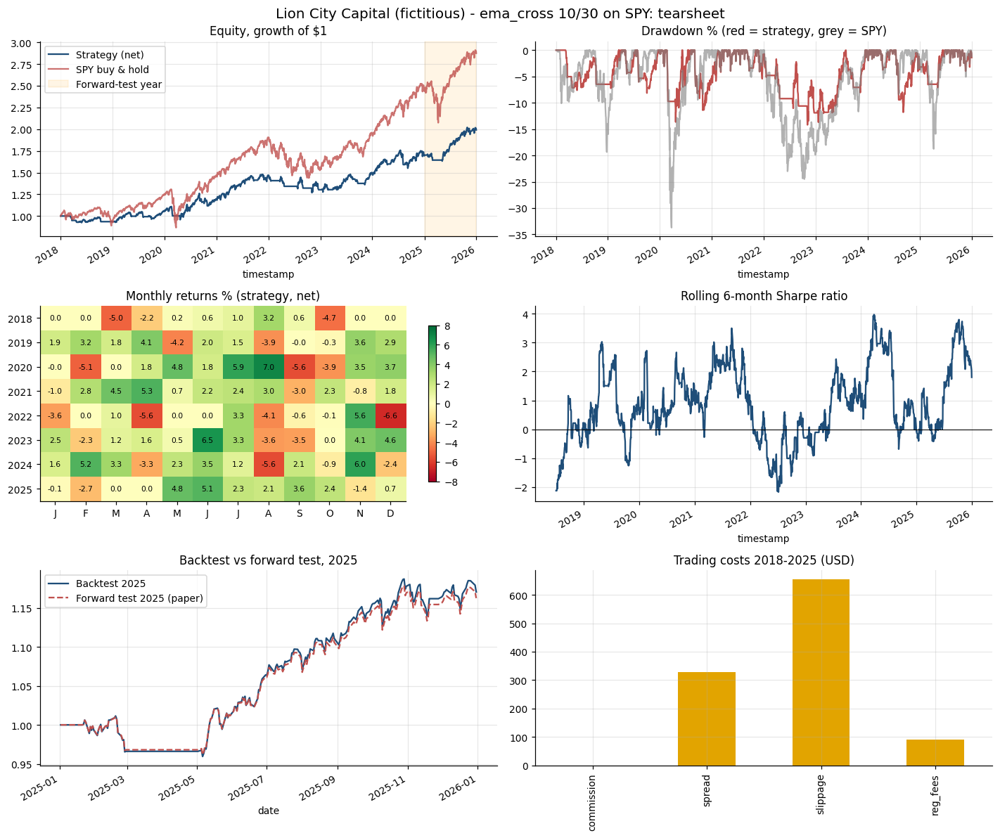

# Lion City Capital (fictitious) - Strategy Performance Report
*ema_cross 10/30 on SPY | prepared 2026-10-18 | for training only*

## 1. Research backtest 2018-2025 (net of costs)
|                 | ema_cross 10/30 (net)   | SPY buy & hold   |
|:----------------|:------------------------|:-----------------|
| Total return    | 99.19%                  | 187.48%          |
| CAGR            | 9.02%                   | 14.15%           |
| Ann. volatility | 11.52%                  | 19.45%           |
| Sharpe          | 0.81                    | 0.78             |
| Sortino         | 1.12                    | 1.09             |
| Max drawdown    | -14.19%                 | -33.72%          |
| Calmar          | 0.64                    | 0.42             |
| Win rate        | 50.00%                  | -                |
| Profit factor   | 3.54                    | -                |
| Trades          | 26                      | 0                |
| Exposure        | 70.61%                  | 100.00%          |
| Alpha           | 4.03%                   | -0.00%           |
| Beta            | 0.35                    | 1.00             |

## 2. Trading costs 2018-2025
|            | USD   |
|:-----------|:------|
| commission | 0     |
| spread     | 327   |
| slippage   | 654   |
| reg_fees   | 91    |
| total      | 1,072 |

## 3. Backtest vs forward (paper) test, 2025
|              | Backtest 2025      | Forward test 2025 (paper)   |
|:-------------|:-------------------|:----------------------------|
| Total return | 17.04%             | 16.25%                      |
| Sharpe       | 1.64               | 1.65                        |
| Max drawdown | -5.14%             | -4.85%                      |
| Orders       | 5                  | 5                           |
| Execution    | model open + costs | avg slippage 1.0 bps        |

## 4. Monitoring checks
| check                 | status   | value                                       |
|:----------------------|:---------|:--------------------------------------------|
| tracking vs backtest  | OK       | -0.79% (limit +/-2%)                        |
| average fill slippage | OK       | 1.0 bps (limit 5 bps)                       |
| drawdown stop rule    | OK       | current -1.34%, worst -4.85% (stop at -15%) |
| kill switch           | OK       | off                                         |
| diagnostics (Lab 18)  | OK       | 1 WARN, no FAIL                             |

## 5. Key insights
- Over 2018-2025 the strategy returned 9.0% a year versus 14.1% for SPY, with a maximum drawdown of -14.2% versus -33.7% - it trades return for lower risk.
- Beta to SPY is 0.35 with 71% exposure; the CAPM alpha of +4.0% a year is an untested point estimate, not proof of skill.
- Costs were small for this low-turnover rule (drag 0.11% a year) - turnover, not commission, drives cost.
- The 2025 paper forward test tracked the backtest within 0.79% of total return; differences come from whole-share sizing, the position cap and fill slippage.
- Monitoring: 5 of 5 checks OK; diagnostics: 1 WARN, no FAIL.

## 6. Recommendation to the investment committee
CONTINUE PAPER TRADING for at least another quarter. The forward test confirms the implementation matches the research, but the strategy has not beaten buy and hold on return. Before any live allocation: add a second uncorrelated signal, keep the drawdown stop rule, and obtain risk-committee sign-off. Paper results only - not investment advice.

